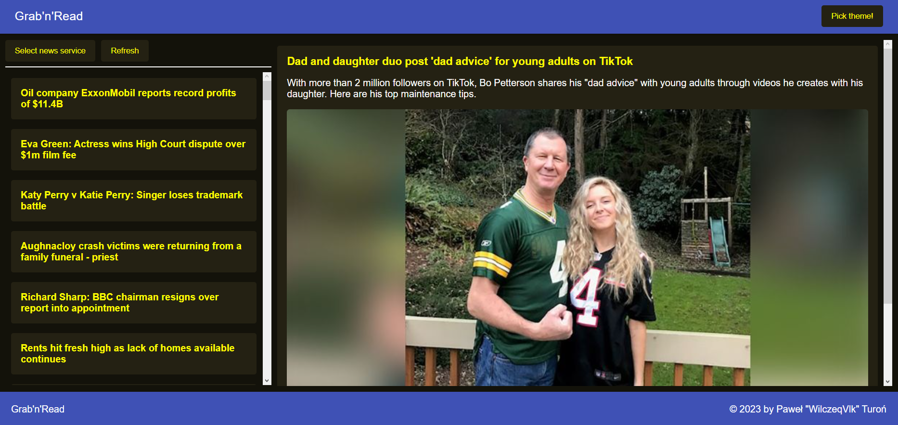
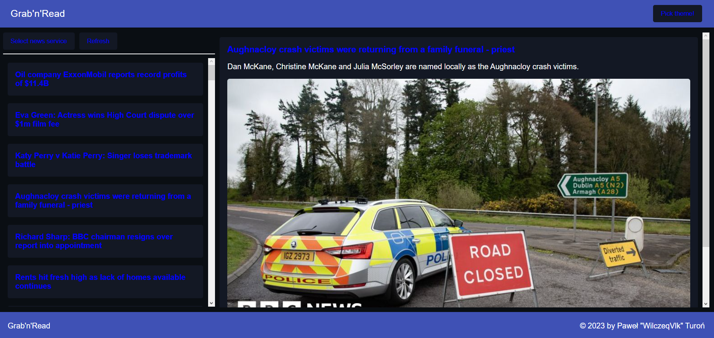
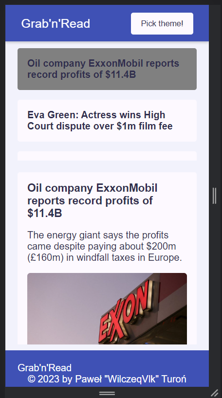

# Grab'n'Read

Grab'n'Read to responsywna aplikacja do przeglądania wiadomości. Pobiera artykuły z serwisu News API i pozwala wybierać między BBC oraz CNN, odświeżać listę oraz przeglądać treść pojedynczego artykułu.

Projekt powstał głównie w celach edukacyjnych i do ćwiczenia tworzenia aplikacji we frameworku Angular.

## Funkcje

- pobieranie artykułów z BBC i CNN,
- wybór źródła wiadomości z poziomu menu,
- ręczne odświeżanie listy artykułów,
- podgląd tytułu, opis, obrazu i treści wybranego artykułu,
- wybór jednego z siedmiu motywów kolorystycznych,
- responsywna lista i widok artykułu.

## Zrzuty ekranu

### Widok na komputerze





### Widok na urządzeniu mobilnym



## Technologie

- Angular 15
- Angular Material
- Angular CDK
- RxJS
- TypeScript
- News API

## Wymagania

- Node.js
- npm
- Angular CLI 15

## Uruchomienie projektu

1. Sklonuj repozytorium i przejdź do jego katalogu:

```bash
git clone https://github.com/pturo/grab-n-read.git
cd grab-n-read
```

2. Zainstaluj zależności:

```bash
npm install
```

3. Zarejestruj się w [News API](https://newsapi.org/) i utwórz klucz API.

4. Ustaw klucz w pliku `src/environments/environments.ts`:

```ts
export const environment = {
  production: false,
  apiKey: 'TWÓJ_KLUCZ_NEWS_API'
};
```

> Nie commituj prawdziwego klucza API do publicznego repozytorium. W produkcyjnym Angularze warto przekazać klucz za pośrednictwem zabezpieczonego backendu lub mechanizmu zmiennych środowiskowych.

5. Uruchom aplikację:

```bash
npm start
```

Aplikacja będzie dostępna pod adresem `http://localhost:4200/`.

## Dostępne komendy

```bash
npm start       # uruchamia serwer deweloperski
npm run build   # buduje aplikację w trybie produkcyjnym
npm test        # uruchamia testy jednostkowe
npm run watch   # buduje aplikację i obserwuje zmiany
```

## Konfiguracja API

Aplikacja pobiera dane z endpointu `https://newsapi.org/v2/everything`. Domyślnie:

- BBC: `domains=bbc.com&language=en`
- CNN: `domains=cnn.com&language=en`

Działanie może zależeć od limitów planu News API oraz dostępności usługi.

## Licencja

Projekt jest rozpowszechniany na warunkach licencji [BSD 2-Clause](LICENSE).

© 2023 Paweł „WilczeqVlk” Turoń


